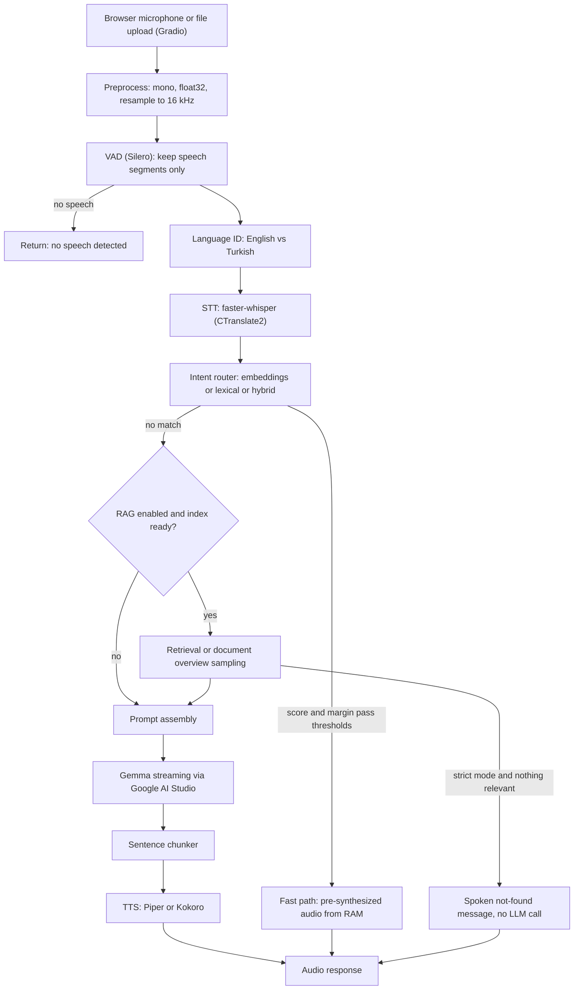

# Voice AI Pipeline Workbench

[](https://colab.research.google.com/github/cem8kaya/AI_voice_pipeline/blob/main/voice_AI_pipeline_v1.ipynb)
[](LICENSE)
[](https://www.python.org/)
[](voice_AI_pipeline_v1.ipynb)
[](https://colab.research.google.com/)
[](https://www.gradio.app/)
[](https://github.com/SYSTRAN/faster-whisper)
[](https://ai.google.dev/gemma)
[](https://pypi.org/project/piper-tts/)
[](#language-handling)
[](https://github.com/cem8kaya/AI_voice_pipeline/commits)
[](https://github.com/cem8kaya/AI_voice_pipeline)

A bilingual (Turkish and English) voice assistant pipeline and benchmarking workbench that runs end to end in Google Colab.
Speech is captured in the browser, transcribed locally, routed through a semantic intent router, optionally grounded in
user-supplied PDF/DOCX documents (RAG), answered by a Gemma model through Google AI Studio, and spoken back with a local
text-to-speech engine. Every stage is configurable at runtime from a Gradio interface and instrumented with latency metrics.

## Table of contents

1. [Design goals](#design-goals)
2. [Architecture](#architecture)
3. [Notebook layout](#notebook-layout)
4. [Quick start](#quick-start)
5. [Pipeline stages in detail](#pipeline-stages-in-detail)
   - [Audio ingest and preprocessing](#1-audio-ingest-and-preprocessing)
   - [Voice activity detection](#2-voice-activity-detection)
   - [Language handling](#language-handling)
   - [Speech-to-text](#3-speech-to-text)
   - [Intent router](#4-intent-router)
   - [Retrieval-augmented generation](#5-retrieval-augmented-generation)
   - [LLM orchestration](#6-llm-orchestration)
   - [Sentence chunking and text-to-speech](#7-sentence-chunking-and-text-to-speech)
   - [Persistence](#8-persistence)
   - [Telemetry and user interface](#9-telemetry-and-user-interface)
6. [Configuration reference](#configuration-reference)
7. [Performance](#performance)
8. [Extending the system](#extending-the-system)
9. [Known limitations](#known-limitations)
10. [Improvement roadmap](#improvement-roadmap)
11. [Troubleshooting](#troubleshooting)
12. [Privacy and data flow](#privacy-and-data-flow)
13. [Licensing and third-party components](#licensing-and-third-party-components)

---

## Design goals

| Goal | How it is addressed |
| :--- | :--- |
| Run completely in Colab | Single notebook, all dependencies installed in the first cell, state persisted to Google Drive |
| Turkish and English | Multilingual Whisper, per-utterance language identification restricted to EN/TR, multilingual embeddings, Turkish Piper voices |
| Low latency on the hot path | Local STT/TTS, intent fast path that bypasses the LLM, sentence-level streaming from the LLM into TTS |
| Measurable | Per-turn latency, real-time factor and token-rate telemetry, P50/P95 aggregation, threshold calibration tools |
| Swappable components | Backend registries for intent routers and RAG embedders, runtime-selectable STT/TTS/LLM models |
| Open-source preference | Apache-2.0 / permissive models and libraries wherever possible (see [Licensing](#licensing-and-third-party-components)) |
| Resumable | Configuration, history, RAG index and model cache survive Colab restarts |

## Architecture



Process model: everything runs in a single Colab kernel process. Gradio serves the UI (optionally through a public
`gradio.live` share link) and invokes the pipeline generator in a worker thread. Model weights live in GPU/CPU memory of
that process; state is mirrored to Google Drive.

## Notebook layout

The repository consists of one notebook, `voice_AI_pipeline_v1.ipynb`. Cells must be run top to bottom.

| Cell | Purpose |
| :--- | :--- |
| 1 | System packages (espeak-ng, ffmpeg, tesseract + Turkish data) and Python dependencies |
| 1.5 | Google Drive mount, `PersistenceManager`, model-cache archive restore |
| 2 | `PipelineConfig` dataclass, Gemma model discovery, `BenchmarkTracker` |
| 3 | `ModelRegistry` (STT, TTS, GenAI client), CUDA library preloading, model warm-up |
| 3.5 | Intent router framework: intent definitions, Turkish-aware normalization, backends, router, calibration helpers |
| 3.6 | RAG layer: DOCX/PDF parsing, chunking, BM25, dense retrieval, fusion, reranker, store |
| 4 | Orchestrator: audio preprocessing, VAD, language ID, STT, routing, RAG, prompt assembly, LLM streaming, TTS streaming |
| 4.5 | State restore from Drive, autosave functions |
| 5 | Gradio user interface, telemetry dashboard, launch |

## Quick start

Requirements

- Google account with Colab; a GPU runtime (T4 is sufficient). CPU works but STT becomes the bottleneck.
- A Google AI Studio API key. Store it as a Colab secret named `GEMINI_API_KEY` (preferred) or as an environment variable.
- Google Drive access (optional but recommended) for persistence.

Steps

1. Open the notebook in Colab using the badge above.
2. Select a GPU runtime (Runtime, Change runtime type).
3. Run cell 1 (installation). If Colab asks for a restart after dependency changes, restart and continue.
4. Run cell 1.5 and authorize Drive access. This cell must run before anything imports Hugging Face libraries.
5. Run the remaining cells in order. The first run downloads several gigabytes of models.
6. Open the `gradio.live` URL printed by the last cell in a separate browser tab (microphone access is unreliable inside the Colab iframe).
7. In the UI, enter the API key if it was not provided through secrets, press "Apply configuration", then record or upload audio.

Approximate model downloads on first run (sizes are indicative)

| Component | Default | Approx. size |
| :--- | :--- | :--- |
| STT | `mobiuslabsgmbh/faster-whisper-large-v3-turbo` | 1.6 GB |
| TTS | Piper `en_US-lessac-medium`, `tr_TR-dfki-medium` | 60 MB each |
| TTS (optional) | Kokoro-82M | 330 MB |
| Intent router | `paraphrase-multilingual-MiniLM-L12-v2` | 220 MB |
| RAG embedder | Qwen3-Embedding-0.6B (fp16 on GPU, int8 on CPU) | 1.1 to 1.2 GB |
| RAG reranker (optional) | `BAAI/bge-reranker-v2-m3` int8 | 570 MB |

## Pipeline stages in detail

### 1. Audio ingest and preprocessing

Gradio delivers `(sample_rate, ndarray)`; browsers typically record at 44.1 or 48 kHz as int16, sometimes stereo (uploaded files).
`prepare_audio_for_stt` performs:

1. Integer PCM to float32 normalization using the dtype range (done before channel mixing, otherwise the scale is lost).
2. Channel averaging to mono.
3. Polyphase resampling to 16 kHz with `scipy.signal.resample_poly` (rational ratio from the GCD of the rates); `numpy.interp` fallback.
4. Clipping to [-1, 1].

Resampling is mandatory: Whisper treats raw arrays as 16 kHz regardless of the actual rate, so skipping it produces
speed-shifted audio and empty or garbled transcripts.

### 2. Voice activity detection

Silero VAD, as bundled with faster-whisper (`faster_whisper.vad.get_speech_timestamps`), is applied before STT.

| Parameter | Default | Effect |
| :--- | :--- | :--- |
| `stt_vad_enabled` | `true` | Disables the whole stage when false |
| `stt_vad_threshold` | `0.5` | Speech probability threshold; higher is stricter and rejects noise more aggressively |
| `stt_vad_min_speech_ms` | `250` | Segments shorter than this are discarded |
| `stt_vad_min_silence_ms` | `500` | Silence needed to split two segments |
| `stt_vad_speech_pad_ms` | `300` | Padding added on both sides of each segment |

Behavior:

- Detected segments are concatenated with 100 ms of zero padding between them; only this speech-only signal is passed to language ID and STT (`vad_filter=False` is then used inside Whisper to avoid running VAD twice).
- If less than 0.2 s of speech remains, the turn ends early with a "no speech detected" message and STT is never invoked.
- The Gradio recorder is blob-based: VAD trims and validates the recording but does not auto-stop the microphone.

### Language handling

The `stt_language` setting accepts `auto`, `en` or `tr`.

- `auto`: for multilingual models, `WhisperModel.detect_language` returns probabilities over all languages; the pipeline compares only `en` and `tr` and picks the larger. The reported confidence is the normalized share `p(best) / (p(en) + p(tr))`. This is evaluated per utterance, so a conversation can switch languages between turns.
- English-only models (distil and `.en` variants) force `en`; the UI shows a warning when Turkish is requested with such a model.
- The detected language propagates downstream: it selects the LLM reply language, the TTS voice, localized system messages and whether router fast-path responses are spoken in English or Turkish.
- Code-switching inside a single utterance is not supported.

### 3. Speech-to-text

| Parameter | Default | Notes |
| :--- | :--- | :--- |
| `stt_model_id` | `mobiuslabsgmbh/faster-whisper-large-v3-turbo` | Multilingual; alternatives: `Systran/faster-whisper-large-v3`, `-medium`, `-small`; English-only: distil-large-v3, distil-small.en |
| `stt_compute_type` | `int8_float16` | `float16`, `int8_float16` or `int8`; automatically falls back to CPU/`int8` when no GPU is present |
| `stt_beam_size` | `1` | Greedy decoding for latency; increase for accuracy |

Implementation notes:

- `condition_on_previous_text=False` prevents hallucination carry-over between segments.
- The registry warms the model with one second of silence at load time to avoid first-request compilation latency.
- CUDA 12 cuBLAS and cuDNN 9 shared libraries from the `nvidia-*` wheels are preloaded with `ctypes` because CTranslate2 expects them while newer Colab images ship CUDA 13 toolchains.
- RTF (real-time factor) is reported as `stt_seconds / audio_seconds`.

### 4. Intent router

Purpose: answer high-frequency, deterministic requests (order status, pricing, greetings, and so on) without an LLM round trip by
replaying pre-synthesized audio from memory.

Decision logic (backend independent):

```
ranked  = backend.scores(normalized_text, lang)  ->  sorted (intent, score) pairs
top1, top2 = ranked[0], ranked[1]
matched = top1.score >= intent_threshold and (top1.score - top2.score) >= intent_margin
```

When `matched` is false the turn continues to RAG or the LLM with the intent name `general_llm_chat`.

Text normalization (`normalize_text`): Unicode NFC, whitespace collapsing, Turkish-aware casing (dotted capital `İ` becomes `i` and
capital `I` becomes dotless `ı`, which Python's `str.lower` gets wrong), and, for lexical backends, diacritic folding
(`ç ğ ı ö ş ü` to `c g i o s u`) with punctuation stripped.

Available backends (selected at runtime; all open source):

| Key | Method | Default threshold / margin | License |
| :--- | :--- | :--- | :--- |
| `emb-minilm-multi` (default) | `paraphrase-multilingual-MiniLM-L12-v2`, cosine max over examples | 0.65 / 0.05 | Apache-2.0 |
| `emb-mpnet-multi` | `paraphrase-multilingual-mpnet-base-v2` | 0.65 / 0.05 | Apache-2.0 |
| `emb-qwen3-q` | Qwen3-Embedding-0.6B int8 (fastembed) | 0.70 / 0.05 | Apache-2.0 |
| `emb-labse` | LaBSE via sentence-transformers | 0.65 / 0.05 | Apache-2.0 |
| `tfidf-char` | scikit-learn TF-IDF, `char_wb` 2 to 5-grams, sublinear tf | 0.50 / 0.05 | BSD-3-Clause |
| `hybrid-minilm-tfidf` | `0.7 * embedding + 0.3 * tfidf` per intent | 0.58 / 0.05 | Apache-2.0 + BSD-3 |

Default thresholds for embedding backends are starting points. Score scales differ per model; calibrate with the built-in tool
before relying on them.

Intents are defined in `DEFAULT_INTENTS` (id, per-language example utterances, per-language fast-path responses). On first run a
copy is written to `state/intents.json` on Drive; editing that file changes the intents on the next start. The fast-path audio
cache is keyed by `(engine, voice, speed, language, intent)` and is rebuilt at startup and whenever the TTS profile changes.

Calibration (`evaluate_intent_router`): a labelled test set (`INTENT_TEST_SET`, 31 utterances in the repository, none of
which overlap the training examples) is scored once, then thresholds from 0.30 to 0.95 are swept. The recommended threshold
is the highest-accuracy value whose wrong-fast-path rate does not exceed 3 percent (ties go to the higher threshold). The
tool reports accuracy, wrong fast-path rate and the share of correct intents that fall through to the LLM. For the
`tfidf-char` backend on the built-in set it selected 0.50 with 71 percent accuracy and 0 percent wrong fast paths; this test
set is deliberately small and should be extended for any real deployment.

### 5. Retrieval-augmented generation

The RAG layer is optional and disabled by default (`rag_enabled=false`).

#### Ingestion

| Format | Parser | Notes |
| :--- | :--- | :--- |
| PDF | `pypdfium2` | Text layer extraction per page; hyphenated line breaks joined; optional Tesseract OCR (`tur+eng`) for pages with fewer than 20 characters |
| DOCX | Built-in parser (`zipfile` + `xml.etree`) | Paragraphs, tables (one row per line, cells joined with a vertical bar), list items, headings detected from style names (`heading`, `baslik`, `title`) or `outlineLvl`, which also covers Turkish Word style IDs |

Uploaded originals are copied to `rag_docs/` on Drive so the index can be rebuilt with different chunking or embedding settings.
Files are deduplicated by SHA-1 and re-indexed when content changes.

#### Chunking

- Sentence-aware splitting (regex on terminal punctuation followed by an uppercase letter, digit or bullet; a list of Turkish and English abbreviations prevents false splits such as "Dr.").
- Target `rag_chunk_words = 120`, overlap `rag_overlap_words = 25`; the overlap is built from whole trailing sentences.
- A chunk is closed on every heading change and every PDF page change, so section and page metadata stay accurate. The current heading is prepended to the chunk text.
- Over-long sentences or table rows are split on word windows.

#### Embedding

| Key | Model | Runtime | Notes |
| :--- | :--- | :--- | :--- |
| `qwen3-gpu` (default on CUDA) | Qwen3-Embedding-0.6B | sentence-transformers, fp16 | Falls back to `qwen3-q` if it cannot be loaded |
| `qwen3-q` | Qwen3-Embedding-0.6B int8 | fastembed ONNX, CPU | Observed at roughly 2 s per chunk on the Colab CPU |
| `mpnet-multi` | paraphrase-multilingual-mpnet-base-v2 | fastembed or sentence-transformers | 512-token window |
| `minilm-multi` | paraphrase-multilingual-MiniLM-L12-v2 | fastembed or sentence-transformers | 128-token window, requires small chunks |

For Qwen3 the query side is prefixed with an instruction (`Instruct: Given a question, retrieve document passages that answer the question` followed by `Query:`);
passages are embedded without it. Vectors are L2-normalized, so retrieval is a dense matrix-vector product held in memory (brute-force exact search).
Embedding is done in batches of 16 and the index is checkpointed to disk after every file.

#### Retrieval

1. Dense scores `X @ q` over all chunks; top `max(3 * top_k, 10)` candidates.
2. BM25 (`k1 = 1.5`, `b = 0.75`) over the same chunks, with a tokenizer tuned for Turkish: Turkish-aware lowercasing, diacritic folding, a small TR/EN stop-word list and prefix-5 truncation as a lightweight stemmer for agglutinative suffixes.
3. Reciprocal Rank Fusion with `k = 60` over both rankings (`rag_use_bm25=true`).
4. Optional cross-encoder reranking of the fused candidates with `BAAI/bge-reranker-v2-m3` (int8, `rag_rerank`).
5. The best dense cosine over the whole index is the relevance signal: if it is below `rag_min_score` (default 0.35) the context is considered irrelevant.

Short follow-up questions (fewer than five words) are expanded with the previous user utterance before retrieval.

#### Document-level questions

Similarity search is the wrong tool for requests such as "summarize the document". `is_overview_query` detects such intents
(Turkish and English keywords such as `ozet`, `summarize`, `overview`, `ana fikir`, or a document noun combined with an "about"
phrase). In that case the similarity gate is bypassed and `overview_hits` builds the context from the first two chunks of every
document plus evenly spaced samples across each document, within a budget of at least 700 words. The prompt instructs the model
to give a short overview and not to claim it read every part. This is a sampling approximation, not a true summary.

#### Answer modes

| Mode | Behavior when nothing relevant is found |
| :--- | :--- |
| `augment` (default) | The LLM is called with a note stating that the documents contain nothing relevant; it may answer from general knowledge or say it could not find the information |
| `strict` | No LLM call; a localized spoken message ("could not find that in the uploaded documents") is returned |

Retrieved excerpts are wrapped in the prompt as untrusted reference text with an explicit instruction not to follow any
instructions contained in them. Total context is capped by `rag_max_context_words` (default 450) to bound prompt size and latency.

### 6. LLM orchestration

The LLM is a Gemma model accessed through the Google AI Studio API (`google-genai`), listed dynamically from the API
(`generateContent`-capable models whose name contains "gemma"), with a static fallback list.

Prompt assembly (`build_gemma_contents`):

- Gemma on this API does not accept a system role, so the system instruction is injected into the first user turn of a sliding window of the last 6 messages.
- Every turn appends a reply-language directive (English or Turkish) derived from language ID.
- When RAG context exists it is placed before the question together with the mode-specific rule; when documents exist but nothing was found, a miss note is added.
- The system instruction requires 1 to 2 short spoken sentences, no markdown, no emoji, and forbids promising future work ("I will prepare it and send it shortly").

Generation parameters

| Parameter | Default | Notes |
| :--- | :--- | :--- |
| `llm_model_id` | `gemma-3-27b-it` | Selectable from the discovered list |
| `llm_temperature` | `0.6` | |
| `llm_max_tokens` | `120` | Visible-answer budget |
| `llm_thinking_reserve` | `1000` | Added to `max_output_tokens`; thinking-capable models spend reasoning tokens from the same budget, and without a reserve the visible answer can be empty |
| `llm_thinking` | `minimal` | `minimal`, `low` or `auto`; sent as `ThinkingConfig(thinking_level=...)`; if the API rejects it before any output, the request is retried once without it |

Streaming details:

- The stream is lazy: authorization, quota and model-name errors surface while iterating, so iteration is inside the error handler. On failure a localized spoken error message is produced and the turn is not added to history.
- Parts flagged as `thought` are discarded; a small state machine also strips `<|channel>thought ... <channel|>` blocks that some deployments return as plain text, including markers split across stream chunks.
- An empty response is detected and reported with finish reason, thinking-token and output-token counts instead of failing silently.
- Token rate is estimated as characters divided by 4 and measured after the first token, so waiting or thinking time is attributed to TTFT rather than to throughput.

### 7. Sentence chunking and text-to-speech

Streamed text is buffered and flushed to TTS when it matches `[.!?,;]+(\s|$)` and contains at least `chunk_min_words` words
(default 4). This lets audio synthesis start before the LLM finishes. Markdown asterisks are removed.

| Engine | Languages | Runtime | Notes |
| :--- | :--- | :--- | :--- |
| Piper (default) | English and Turkish | ONNX, CPU | Voices: `en_US-lessac-medium`, `-amy-medium`, `-ryan-medium`, `-joe-medium`; `tr_TR-dfki-medium`, `-fahrettin-medium`, `-fettah-medium`; speed mapped to `length_scale = 1 / speed`; supports both the current and legacy `piper-tts` APIs |
| Kokoro-82M | English | PyTorch, 24 kHz | Voices `af_heart`, `af_bella`, `am_adam`, `am_michael`; output tensors are converted to float32 numpy |

Language routing (`resolve_tts`): Turkish always uses Piper with the configured Turkish voice, even when Kokoro is selected,
because Kokoro has no Turkish support. English uses the selected engine. The UI voice list follows the selected engine.

### 8. Persistence

Layout on Drive (`MyDrive/voice_ai_workbench/`):

| Path | Content |
| :--- | :--- |
| `state/config.json` | Full `PipelineConfig` (API key excluded unless explicitly enabled) |
| `state/chat_history.json` | Last 60 messages |
| `state/benchmark.json` | Last 300 turns and the latest turn |
| `state/intents.json` | Editable intent definitions (created once, never overwritten) |
| `state/persist_opts.json` | Autosave and API-key storage flags |
| `rag_index/` | `rag_meta.json` (chunks, documents, embedder key) and `rag_embeddings.npy` |
| `rag_docs/` | Original uploaded PDFs and DOCX files |
| `model_archives/` | TAR archives of the Hugging Face and fastembed model caches |

Mechanics:

- JSON and index writes are atomic (temporary file, `fsync`, `os.replace`); unreadable files are renamed to `*.corrupt-<timestamp>` instead of being overwritten.
- Autosave runs from the UI refresh timer when a state signature (config, history length, last message, benchmark length, RAG revision) changes, at most every 5 seconds. Applying configuration, applying RAG settings and finishing an indexed file force a save. RAG indexing checkpoints after each file.
- Model caches stay on local disk. Google Drive does not support symbolic links; the Hugging Face cache is built from symlinks, and storing it directly on Drive turns model files into small text files containing relative paths, which breaks loading (CTranslate2 reports an unsupported binary version). New complete repositories are therefore archived to Drive as TAR files in a background thread (checked roughly every 60 seconds while the UI is open) and extracted to the local cache at startup. Incomplete downloads are never archived.
- Self-healing: if STT or embedding model loading fails with a corruption-like error, the local cache entry and its Drive archive are removed and the model is downloaded again once.

### 9. Telemetry and user interface

Per-turn metrics

| Metric | Definition |
| :--- | :--- |
| STT latency / RTF | Time from VAD start to transcript; divided by audio duration for RTF |
| Intent latency | Embedding and scoring time only |
| RAG latency | Retrieval or overview construction time |
| TTFT | Time from LLM request to first visible token |
| Tokens per second | Estimated visible tokens over generation time after the first token |
| TTS first audio | Synthesis time of the first audio chunk |
| TTS RTF | Total synthesis time over total synthesized audio duration |
| End-to-end | Time from pipeline start to the first audio chunk of the response, measured server-side |
| P50 / P95 | Percentiles of end-to-end over the session history |

Each turn also shows detected language, VAD speech ratio, router decision with the two nearest intents, RAG retrieval summary
(sources and pages), LLM usage metadata (thinking, output and prompt tokens), and errors.

Interface labels are in Turkish. Tabs: AI Studio (model, temperature, sentence chunker, thinking level), STT and VAD, TTS, Intent Router (backend,
thresholds, test box, calibration), RAG (upload, indexing, search test, answer mode, index save/load), Persistence (status,
manual save and load, disk usage, model backup, cleanup).

## Configuration reference

All settings live in `PipelineConfig` and are editable from the UI. Defaults below are the shipped values.

| Group | Parameter | Default | Tuning notes |
| :--- | :--- | :--- | :--- |
| LLM | `llm_model_id` | `gemma-3-27b-it` | Smaller models lower latency; thinking models need `llm_thinking` |
| LLM | `llm_temperature` | 0.6 | Lower for factual RAG answers |
| LLM | `llm_max_tokens` | 120 | Raise for longer spoken answers |
| LLM | `llm_thinking` | `minimal` | `auto` can add many seconds of TTFT on Gemma 4 |
| LLM | `llm_thinking_reserve` | 1000 | Only consumed if the model thinks |
| LLM | `chunk_min_words` | 4 | Lower reduces time to first audio, may fragment prosody |
| STT | `stt_model_id` | `mobiuslabsgmbh/faster-whisper-large-v3-turbo` | |
| STT | `stt_compute_type` | `int8_float16` | |
| STT | `stt_beam_size` | 1 | |
| STT | `stt_language` | `auto` | `auto`, `en`, `tr` |
| VAD | `stt_vad_enabled` | true | |
| VAD | `stt_vad_threshold` | 0.5 | Raise in noisy rooms, lower for quiet speakers |
| VAD | `stt_vad_min_speech_ms` | 250 | |
| VAD | `stt_vad_min_silence_ms` | 500 | |
| VAD | `stt_vad_speech_pad_ms` | 300 | |
| Router | `intent_backend` | `emb-minilm-multi` | See backend table |
| Router | `intent_threshold` | 0.65 | Calibrate per backend |
| Router | `intent_margin` | 0.05 | Guards against near-ties between intents |
| Router | `enable_fast_path_cache` | true | Disable to force every turn through the LLM |
| RAG | `rag_enabled` | false | |
| RAG | `rag_embed` | `qwen3-q` (`qwen3-gpu` when CUDA is available) | Changing it re-embeds the index |
| RAG | `rag_chunk_words` / `rag_overlap_words` | 120 / 25 | Keep chunks within the embedder window |
| RAG | `rag_top_k` | 3 | Raise for multi-part questions |
| RAG | `rag_min_score` | 0.35 | Cross-language queries (for example Turkish question, English document) score lower; inspect with the search test |
| RAG | `rag_use_bm25` | true | |
| RAG | `rag_rerank` | false | Adds model load time and per-query CPU latency |
| RAG | `rag_mode` | `augment` | `augment` or `strict` |
| RAG | `rag_ocr` | false | Requires Tesseract with Turkish data |
| RAG | `rag_max_context_words` | 450 | Overview mode uses at least 700 |
| TTS | `tts_engine` | `piper` | `piper` or `kokoro` |
| TTS | `tts_voice` | `af_heart` | Kokoro voice |
| TTS | `piper_voice_en` / `piper_voice_tr` | `en_US-lessac-medium` / `tr_TR-dfki-medium` | |
| TTS | `tts_speed` | 1.05 | |

Environment and module-level options (cell 1.5): `USE_GOOGLE_DRIVE`, `MODEL_CACHE_ON_DRIVE`, `APP_FOLDER_NAME`; optional environment
variable `VOICE_AI_PERSIST_DIR` overrides the storage root.

## Performance

Metric targets shown on the dashboard

| Layer | Target |
| :--- | :--- |
| STT | RTF below 0.15 |
| Intent router | below 25 ms |
| LLM time to first token | below 350 ms |
| TTS | RTF below 0.25 |
| End-to-end to first audio | below 650 ms |

The TTFT and end-to-end targets are generally not reachable when the LLM is a remote API; they are best read as upper design bounds.

Observed values during development (Colab T4, single runs, indicative only, not a benchmark)

| Measurement | Configuration | Value |
| :--- | :--- | :--- |
| STT | distil-large-v3 (English only), `int8_float16`, beam 1, 6.8 s audio | 390 ms, RTF 0.058 |
| STT | large-v3-turbo, `int8_float16`, beam 1, 6.4 s audio | 757 ms, RTF 0.119 |
| Intent router | MiniLM multilingual, CPU | 6 to 10 ms |
| TTS (Piper) | Turkish voice | first audio 343 ms, RTF 0.056 |
| RAG query | Qwen3-Embedding int8 on CPU, 147 chunks | 752 ms |
| RAG query | Qwen3-Embedding fp16 on GPU | about 80 ms |
| RAG indexing | Qwen3-Embedding int8 on CPU, 147 chunks | 288 s |
| LLM TTFT | `gemma-4-31b-it`, default thinking | 17.1 s (end-to-end 19.6 s) |
| LLM TTFT | `gemma-4-31b-it`, `thinking_level=minimal`, 124 prompt tokens, 24 output tokens | 1.1 s |

Latency budget guidance

1. The LLM dominates. Reduce it first: pick a non-thinking or smaller model, keep `llm_thinking=minimal`, limit RAG context.
2. Use the GPU embedder for RAG; CPU int8 Qwen3 is acceptable for querying but slow for indexing.
3. Use the intent fast path for frequent requests; it removes the LLM round trip (and RAG) entirely for those turns.
4. Prefer Piper for latency on CPU; Kokoro is English only and uses the GPU.
5. Reduce `stt_model_id` size or beam width only after the above, since STT is typically a minor share of the budget.

## Extending the system

### Add a custom intent router

```python
class MyBackend(IntentBackend):
    def fit(self, intents):
        texts, labels, langs = _flatten_examples(intents)   # build your index or train your model
    def scores(self, text, lang):
        return {"check_order_status": 0.91, "pricing_inquiry": 0.07}   # intent_id -> score

register_intent_backend("my-router", "My router", lambda: MyBackend(),
                        default_threshold=0.6, license="Apache-2.0")
ROUTER.activate("my-router")
```

Register backends before running the UI cell so they appear in the dropdown. Use `ROUTER.set_intents([...])` and `save_intents()` to replace and persist the intent set.

### Add a RAG embedder

```python
register_rag_embedder("my-embedder", "Label", "org/model-id", library="st",
                      query_instruction=None, max_tokens=512, half=True, fallback="qwen3-q")
```

### Other extension points

- STT: any CTranslate2 Whisper repository can be added to the model dropdown; `ModelRegistry.get_stt` is the single loading point.
- TTS: add entries to `PIPER_VOICES` (name to Hugging Face path and language); voice downloads use `rhasspy/piper-voices`.
- LLM: `build_gemma_contents` and the streaming block in `configurable_voice_pipeline` are the only provider-specific parts.
- Evaluation: `INTENT_TEST_SET` and `evaluate_intent_router` can be replaced with a larger labelled set.

## Known limitations

- Output is not streamed to the browser. The pipeline generator yields audio chunks, but the HTTP-mode handler concatenates them and returns one clip. Perceived latency is therefore the full pipeline time, while the reported end-to-end metric is time to first synthesized chunk.
- Input is record-then-process; there is no live microphone streaming, no streaming STT and no barge-in. VAD is applied to finished recordings only.
- A single global session: configuration, chat history and the RAG index are process-wide, so concurrent users share state.
- The LLM is a remote service subject to quota, rate limits and network latency; the free tier is not suitable for load.
- Language ID is per utterance and restricted to English and Turkish; mixed-language utterances and other languages are not handled.
- Router quality depends entirely on example coverage; there is no learned classifier, slot filling or out-of-domain training class beyond the threshold and margin test.
- RAG index is an in-memory exact search. It is adequate for tens of thousands of chunks but has no ANN index, metadata filtering or deletion of individual documents without a re-embed of that source.
- Document structure: PDF layout, multi-column text and tables are flattened; DOCX has no page numbers (citations use headings); OCR has not been validated on scanned Turkish documents.
- Overview answers are based on sampled excerpts and can miss content from unsampled sections.
- Piper voice quality and Turkish number, date and abbreviation verbalization have not been evaluated systematically.
- Whisper may hallucinate on near-silent or noisy input that passes VAD.
- Prompt-injection mitigation for documents is instruction-level only and not a security boundary.
- The public `gradio.live` link has no authentication.
- The repository contains no automated tests or CI; behavior was verified interactively in Colab.

## Improvement roadmap

Latency and interaction

- Stream audio to the browser (generator output with `streaming=True` or WebRTC) so time to first audio equals perceived latency.
- Live microphone input with incremental VAD end-pointing, chunked or streaming STT, and barge-in (cancel TTS and LLM generation on new speech).
- Overlap stages: start routing and retrieval on partial transcripts, prefetch the LLM connection, cache embeddings of recent queries.
- Evaluate a local LLM path (llama.cpp or vLLM with a quantized Gemma) to remove API latency and quota constraints.
- Lower first-audio latency with adaptive chunking (flush on clause boundaries, shorter first chunk).

Retrieval quality

- Maximal Marginal Relevance or per-section diversity to avoid near-duplicate neighbors; query decomposition for multi-part questions.
- History-aware query rewriting with the LLM instead of the current concatenation heuristic.
- Parent-child or sliding-window chunk expansion, layout-aware parsing (tables, columns, headings in PDF), and metadata-filtered search.
- Index-time per-document summaries (map-reduce) stored on Drive, used for overview questions and for document routing.
- ANN index (FAISS or hnswlib) and per-document deletion for large corpora.
- Retrieval evaluation harness: labelled question set with recall@k and MRR per embedder, with and without BM25 and reranking.
- Answer citations in the UI with page highlights.

Router

- Learned classifier on top of embeddings (logistic regression or SetFit), active learning from LLM-fallback logs, an explicit out-of-domain class.
- LLM arbitration for low-margin cases and slot extraction (order number, dates) with structured output.
- Larger Turkish and English test sets, per-intent thresholds, and drift monitoring.

Speech

- Word and character error rate evaluation on Turkish speech (for example Common Voice) across Whisper variants and compute types.
- Turkish text normalization for TTS (numbers, currencies, abbreviations) and SSML-style prosody control.
- Additional Turkish TTS options and a speaker-quality comparison under an agreed license policy.

Engineering

- Extract notebook code into an installable package with unit tests, type checking and CI; keep the notebook as a thin driver.
- Structured logging and metrics export (OpenTelemetry or Prometheus), plus persistent per-turn traces for regression comparison.
- Session-scoped state for multi-user operation; authentication and rate limiting on the public endpoint.
- Secrets handling review, PII controls for documents and chat history stored on Drive, and retention settings.
- Pinned, locked dependency versions to avoid drift in Colab base images.

## Troubleshooting

| Symptom | Cause | Resolution |
| :--- | :--- | :--- |
| `Unsupported model binary version ... v774843950` while loading Whisper | Model cache stored on Google Drive turned symlinks into text files (`../..` bytes) | Use the current notebook, restart the runtime, rerun from cell 1.5. Optionally delete the legacy `voice_ai_workbench/cache` folder with `PERSIST.cleanup_legacy_cache()` |
| Empty or very slow LLM answers with Gemma 4 | Thinking tokens consume the output budget or add seconds of TTFT | Keep `llm_thinking=minimal` and `llm_thinking_reserve` at 1000, or choose a non-thinking model |
| Reply says it will prepare something later | Retrieval found nothing relevant and the model improvised | Current prompts forbid this; for document-wide questions ask for a summary or overview, or lower `rag_min_score` |
| "No speech detected" | VAD rejected the recording | Lower `stt_vad_threshold`, check microphone level, or disable VAD |
| Turkish speech transcribed as English garbage | English-only STT model selected | Select a multilingual Whisper model and set language to `auto` or `tr` |
| Microphone does not work in Colab output | Embedded iframe restrictions | Open the `gradio.live` link in a separate tab |
| `libcublas.so.12` or cuDNN errors | CUDA toolkit mismatch with CTranslate2 | Install the `nvidia-cublas-cu12` and `nvidia-cudnn-cu12` wheels; the notebook preloads them when present |
| RAG indexing very slow | CPU int8 embedder | Use a GPU runtime and the `qwen3-gpu` embedder |
| HF libraries imported before cell 1.5 | Cache paths already fixed | Restart the runtime and run cell 1.5 before other cells |

## Privacy and data flow

- Audio never leaves the Colab runtime: VAD, language ID and STT run locally.
- The text sent to Google AI Studio consists of the transcript, recent conversation turns (up to 6 messages), the system instruction and, when RAG is active, selected document excerpts. Review the provider terms before using confidential documents.
- Router and RAG embeddings are computed locally.
- Drive stores configuration, chat history, benchmark data, the RAG index and the original uploaded documents in plain files under your own account. The API key is not written unless explicitly enabled; prefer Colab secrets.
- Delete `voice_ai_workbench/` from Drive (or use the cleanup controls in the Persistence tab) to remove stored data.

## Licensing and third-party components

The notebook and repository content are released under the MIT License (see `LICENSE`). Third-party components keep their own
licenses; the table lists the licenses declared by the packages or model metadata used during development. Verify the
upstream license of every model and voice before redistributing a derived work. This section is informational, not legal advice.

| Component | Role | License |
| :--- | :--- | :--- |
| faster-whisper | STT runtime | MIT |
| Whisper large-v3-turbo (CTranslate2 conversion) | STT weights | See upstream model card |
| fastembed | ONNX embeddings and reranker runtime | Apache-2.0 |
| sentence-transformers | Embedding runtime | Apache-2.0 |
| Qwen3-Embedding-0.6B, paraphrase-multilingual-MiniLM-L12-v2, paraphrase-multilingual-mpnet-base-v2, BAAI/bge-reranker-v2-m3 | Embedding and reranking models | Apache-2.0 (as declared in fastembed model metadata) |
| LaBSE | Optional router embedder | Apache-2.0 (per upstream model card) |
| scikit-learn, scipy, pandas, psutil | Lexical router, DSP, tables, system metrics | BSD-3-Clause |
| pypdfium2 | PDF text extraction | BSD-3-Clause or Apache-2.0 |
| Tesseract OCR, pytesseract | Optional OCR | Apache-2.0 |
| Gradio | User interface | Apache-2.0 |
| google-genai | Google AI Studio client | Apache-2.0 |
| Gemma (via API) | LLM | Gemma Terms of Use and Google API terms; not Apache-2.0 |
| Kokoro (library) | Optional English TTS | Apache-2.0 |
| piper-tts (current releases) | Default TTS runtime | GPL-3.0-or-later |
| Piper voices | TTS weights | Per-voice licenses; check each voice's model card |
| espeak-ng | Phonemization (Piper, Kokoro) | GPL-3.0 |

Note on copyleft: the default TTS stack depends on GPL-licensed components (Piper runtime and espeak-ng). Using them from a
notebook for private or internal work is different from distributing a combined application. If you plan to redistribute, review
the obligations or substitute a permissively licensed TTS path.
